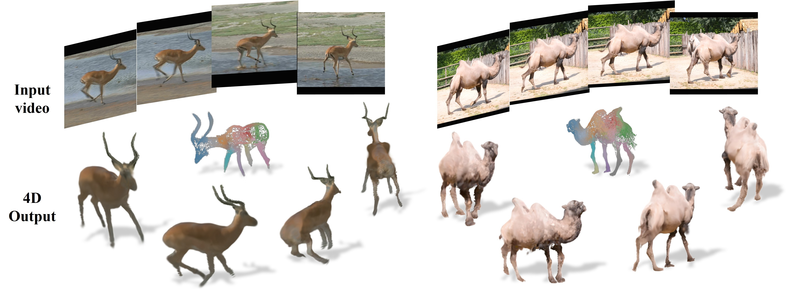
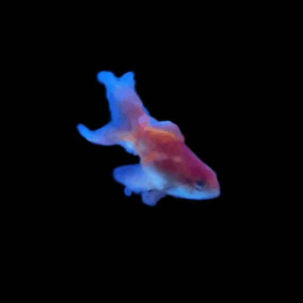
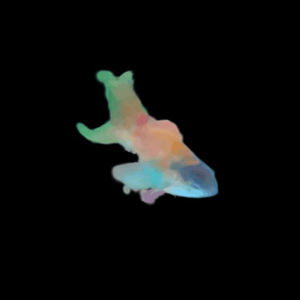
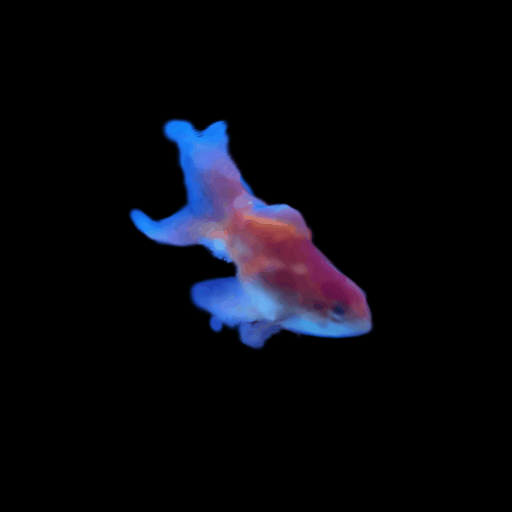
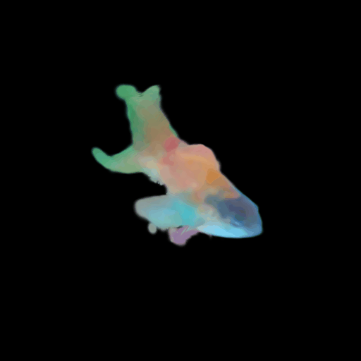

<div align="center">

# ReWild4D

**Progressive Pose-Guided 4D Animal Reconstruction from Monocular Video · ECCV 2026 (Spotlight)**

[Paper](https://media.eventhosts.cc/Conferences/ECCV2026/pdfs/7269.pdf) · [Project Page](https://syl-322.github.io/ReWild4D/) · [Data](#data-and-download)

[Installation](#installation) · [Optimization](#optimization) · [Evaluation](#evaluation) · [Citation](#citation)

</div>

Official implementation of **ReWild4D**, with per-video optimization, rendering, and evaluation code for DAVIS, APTv2,
and Artemis.



## Installation

The code was validated with **Python 3.10, PyTorch 2.5.1, and CUDA 12.1**. Building the CUDA extensions also
requires a local CUDA toolkit (`nvcc`) and a C++ compiler; validation used CUDA 12.4 for extension builds.

Run the following commands from the repository root:

```bash
conda env create -f environment.yml
conda activate rewild4d

# PyTorch3D (the revision used for validation).
pip install "git+https://github.com/facebookresearch/pytorch3d.git@2d4d345b6fd2720580bff5f63dcbd3b230b43996" --no-build-isolation

# Gaussian rasterizer with depth, normal, and alpha rendering.
pip install ./submodules/diff-gaussian-rasterization --no-build-isolation --no-deps --force-reinstall
```

Our bundled rasterizer is based on the
[Gaussian rasterizer fork](https://github.com/slothfulxtx/diff-gaussian-rasterization), which provides depth,
normal, and alpha rendering. On top of that fork, we:

- Fix the recovery of the camera-facing normal sign in the CUDA backward pass.
- Correct the scale gradient when `scaling_modifier` differs from 1.
- Extend the Python interface to accept precomputed covariance and normals together.

## Data and Download

Download the datasets you need from **Assets** on this repository's **Releases** page.

The processed data includes RGB crops, foreground masks, cameras, Fauna initialization, and Artemis
evaluation ground truth. No mask generation or Fauna inference is needed.

Our evaluation covers **100 videos** across DAVIS (8), APTv2 (68), and Artemis (24).
See the [paper](https://media.eventhosts.cc/Conferences/ECCV2026/pdfs/7269.pdf) and
[project page](https://syl-322.github.io/ReWild4D/) for quantitative results and visual comparisons.

We do not distribute the online videos used in the paper because their copyright and redistribution
permissions have not been clarified.

| Dataset | Sequences | Monocular frames | Release asset |
|---|---:|---:|---|
| DAVIS | 8 | 665 | `ReWild4D_DAVIS.tar.gz` |
| APTv2 | 68 | 1,067 | `ReWild4D_APTv2.tar.gz` |
| Artemis | 24 | 3,837 | `ReWild4D_Artemis.tar.gz` |
| Goldfish (optional extra) | 1 | 78 | `ReWild4D_Extra.tar.gz` |

The goldfish package contains an additional DAVIS sequence for the [single-video example](#optimize-one-video) below.

After downloading your selected assets, extract them into the same `DATA_ROOT` folder.
Run only the extraction commands for the packages you downloaded:

```bash
export DATA_ROOT=/absolute/path/to/data
mkdir -p "$DATA_ROOT"
tar -xzf ReWild4D_DAVIS.tar.gz -C "$DATA_ROOT"
tar -xzf ReWild4D_APTv2.tar.gz -C "$DATA_ROOT"
tar -xzf ReWild4D_Artemis.tar.gz -C "$DATA_ROOT"
# Optional extra goldfish sequence.
tar -xzf ReWild4D_Extra.tar.gz -C "$DATA_ROOT"
```

Directory layout:

```text
data/
├── DAVIS_processed/<scene>/cropped/
├── APTv2/<animal>/<clip>/cropped/
├── extra/goldfish/cropped/              # optional
└── Artemis_processed/
    ├── train/<animal>/<motion>/cropped/
    └── eval/{views,geometry}/
```

Use an absolute `DATA_ROOT` path and keep the supplied directory structure and frame names.
Each `cropped/` folder contains `images/`, `masks/`, and Fauna initialization (`fauna/prior.obj` and
`fauna/W0.npy`), plus the following annotations:

| Data | Files relative to `cropped/` |
|---|---|
| DAVIS/APTv2/goldfish | `fauna/transforms_wflip_wRobust.json`, `fauna/poses.npy`, `fauna/poses_flip.npy` |
| Artemis | `mapping_info.json`, `artemis/transforms_artemis.json`, `artemis/val_info.json` |

The current `is_robust` flags in `transforms_wflip_wRobust.json` were filtered by Codex from the estimated camera
positions, replacing the empirical filtering rules used in the paper.

The Artemis data is a processed subset of
[*Artemis: Articulated Neural Pets with Appearance and Motion Synthesis*](https://doi.org/10.1145/3528223.3530086).

## Optimization

A separate 4D representation is optimized for each input video. Run the following commands from the
repository root.

### Optimize one video

Download and extract `ReWild4D_Extra.tar.gz` as described above, then reconstruct and evaluate the goldfish video:

```bash
export DATA_ROOT=/absolute/path/to/data
export OUTPUT_ROOT=/absolute/path/to/output
export CUDA_VISIBLE_DEVICES=0

(cd real && bash scripts/run_scene.sh configs/animal.yaml extra goldfish)
```

This optimizes the reconstruction for 20,000 iterations, renders predictions, and computes metrics. Results
are saved in `$OUTPUT_ROOT/extra/goldfish/`. For optimization only, prefix `bash` with `EVAL=0` in the command above.

| | RGB | Skinning weights |
|---|:---:|:---:|
| 4D |  |  |
| 3D |  |  |

For a single APTv2 or Artemis sequence, use the corresponding configuration and scene name:

```bash
(cd real && bash scripts/run_scene.sh configs/aptv2.yaml APTv2 2dog/v12c1)
(cd artemis && bash scripts/run_scene.sh configs/artemis.yaml Artemis_processed wolf/Run)
```

### Optimize all sequences in a dataset

With the same environment variables, run the launcher for your chosen dataset:

```bash
# DAVIS
bash real/scripts/train_davis.sh

# APTv2
bash real/scripts/train_aptv2.sh

# Artemis
bash artemis/scripts/train_artemis.sh
```

Each launcher optimizes a separate model for every sequence, renders predictions, computes metrics, and
writes a dataset summary. Set `EVAL=0` to run optimization only.
Checkpoints and per-sequence results are saved in `OUTPUT_ROOT/<dataset>/<scene>/`; dataset averages are
saved as `OUTPUT_ROOT/summary_<dataset>_<iteration>.json`.

| Dataset | Configuration | Iterations |
|---|---|---:|
| DAVIS | [real/configs/animal.yaml](real/configs/animal.yaml) | 20,000 |
| APTv2 | [real/configs/aptv2.yaml](real/configs/aptv2.yaml) | 10,000 |
| Artemis | [artemis/configs/artemis.yaml](artemis/configs/artemis.yaml) | 20,000 |

Append optimization arguments to `scripts/run_scene.sh` to override the configuration. Resolved settings are
saved in `training_config.json` under the model folder. Changing `--iterations` does not rescale loss cutoff
iterations; override those separately when changing the regularization schedule.

## Evaluation

The optimization launchers already render predictions and compute metrics. To evaluate existing checkpoints,
run the commands below from the repository root.

### Evaluate a dataset

```bash
export DATA_ROOT=/absolute/path/to/data
export OUTPUT_ROOT=/absolute/path/to/output
export CUDA_VISIBLE_DEVICES=0

python -m evaluation.evaluate_dataset --dataset DAVIS \
  --data_root "$DATA_ROOT" --output_root "$OUTPUT_ROOT" --render
python -m evaluation.evaluate_dataset --dataset APTv2 \
  --data_root "$DATA_ROOT" --output_root "$OUTPUT_ROOT" --render
python -m evaluation.evaluate_dataset --dataset Artemis \
  --data_root "$DATA_ROOT" --output_root "$OUTPUT_ROOT" --render
```

Each command renders predictions from existing checkpoints, computes every sequence's metrics, and writes
`OUTPUT_ROOT/summary_<dataset>_<iteration>.json`. Default iterations are 20,000 for DAVIS/Artemis and
10,000 for APTv2. Omit `--render` to recompute metrics from saved predictions.
Use `--iteration` to select another checkpoint.

### Evaluate one video

For DAVIS and APTv2 (use `--iteration 10000` for APTv2), use the corresponding model path:

```bash
MODEL_PATH=/absolute/path/to/output/DAVIS_processed/camel
(cd real && python render_eval.py -m "$MODEL_PATH" --iteration 20000)
python -m evaluation.evaluate real -m "$MODEL_PATH" --iteration 20000
```

For Artemis:

```bash
MODEL_PATH=/absolute/path/to/output/Artemis_processed/wolf/Run
(cd artemis && python render_eval.py -m "$MODEL_PATH" --iteration 20000)
python -m evaluation.evaluate artemis -m "$MODEL_PATH" --iteration 20000
```

If predictions already exist, run only the evaluator. 

If the data has moved, add
`-s /new/path/to/cropped` to both commands.

### Render GIFs

For DAVIS and APTv2, add `--save_gif` to the `real/render_eval.py` command above.
GIFs are saved under `eval_<iteration>/gifs/` in the model folder.

For Artemis:

```bash
MODEL_PATH=/absolute/path/to/output/Artemis_processed/wolf/Run
(cd artemis && python render_4d.py -m "$MODEL_PATH" --iteration 20000)
```

This saves RGB and skin-weight GIFs under `eval_20000_gifs/`. Use `--output_dir` to change the destination
or `--skip_skin` to render only RGB.

<details>
<summary>Evaluation options, outputs, and summaries</summary>

Add these flags to both the renderer and evaluator to select the outputs you need:

| Dataset | Flag | Outputs evaluated |
|---|---|---|
| DAVIS/APTv2 | `--skip_novel` | Input-view images |
| DAVIS/APTv2 | `--skip_input` | Novel-view images and videos |
| Artemis | `--skip_chamfer` | Novel-view images |
| Artemis | `--skip_views` | Geometry |

Artemis ground truth is found automatically under `Artemis_processed/eval/{views,geometry}/`.
To override it, pass `--gt_path` (the scene folder containing `images/`) or `--chamfer_root`
(the folder containing `gt/` and `metadata.json`) to the evaluator.

Outputs below are relative to the model folder:

| Path | Contents |
|---|---|
| `eval_<iteration>/{original_pred,original_GT}/` | Real input-view predictions and references |
| `eval_<iteration>/novel_views_64/` | Real novel-view predictions |
| `eval_<iteration>/<source_frame>/<view>.jpg` | Artemis novel-view predictions |
| `eval_<iteration>/predicted_points.npz` | Artemis world-space geometry and source frame IDs |
| `eval_<iteration>/metrics_<iteration>_wGT.json` | PSNR, SSIM, LPIPS |
| `eval_<iteration>/{kid_results_16,fvd_results_64}.json` | KID-V, FVD-F, FVD-Diag |
| `eval_<iteration>/chamfer_<iteration>.json` | CD/diag and F-scores |

To summarize existing metrics without rendering or recomputing them:

```bash
OUTPUT_ROOT=/absolute/path/to/output
python -m evaluation.summarize real --output_root "$OUTPUT_ROOT" --data_name DAVIS_processed --iteration 20000
python -m evaluation.summarize real --output_root "$OUTPUT_ROOT" --data_name APTv2 --iteration 10000
python -m evaluation.summarize artemis --output_root "$OUTPUT_ROOT" --data_name Artemis_processed --iteration 20000
```

Summaries give sequences equal weight. Missing or invalid results stop aggregation; use `--allow_partial`
to summarize available results, or `--scenes ...` to select sequences explicitly.

</details>

<details>
<summary>Metric definitions</summary>

- **Image metrics:** real videos use held-out `is_val` frames marked robust in either camera-estimation
  stream, with prediction and reference RGBA composited onto black. Artemis uses held-out camera views
  from `artemis/val_info.json` on white backgrounds. LPIPS uses AlexNet.
- **KID-V:** compares robust input frames with 16 rotation views per retained validation frame
  (indices `0, 4, ..., 60` of 64 views), on white backgrounds at 512 × 512. Scores are unscaled.
  Defaults are seed 0 and `--eval_n_spin 16`; the view count must divide 64.
- **FVD-F / FVD-Diag:** following [SV4D](https://arxiv.org/abs/2407.17470), compare input and generated
  videos using I3D features at 224 × 224 on white backgrounds. FVD-F averages views `0, 16, 32, 48`;
  FVD-Diag uses view `t % 64` at retained frame `t`. Each video produces one embedding, so the per-sequence
  Fréchet calculation reduces to squared feature distance.
- **Geometry:** sample 10,000 Gaussian centers per frame. Align each cloud to ground truth with similarity-ICP. CD/diag averages the two directional
  mean nearest-neighbor distances and divides by the rest-pose bounding-box diagonal. F@1%/2%/5% use
  strict thresholds at those fractions of the same diagonal. Scores average over frames.
  Reference geometry uses 10,000 points sampled from the original Artemis voxel surfaces,
  then deformed with official linear blend skinning.

Keep the supplied frame names and annotations. Geometry frame IDs must match the source indices in
`transforms_artemis.json`, including gaps. Metric settings and environment information are saved in
`evaluation_metadata.json` alongside the metrics.

The [FVD utility](evaluation/metrics/fvd/styleganv/fvd.py) uses the
[StyleGAN-V implementation](https://github.com/universome/stylegan-v/blob/master/src/metrics/frechet_video_distance.py)
and its [comparison tools](https://github.com/universome/fvd-comparison). I3D weights download on first use.
For a manual download, obtain the [I3D checkpoint](https://www.dropbox.com/s/ge9e5ujwgetktms/i3d_torchscript.pt?dl=1)
and set `REWILD_I3D_PATH=/absolute/path/to/i3d_torchscript.pt`.

</details>

## Citation

If you use ReWild4D in your research, please cite our ECCV 2026 paper:

```bibtex
@inproceedings{li2026rewild4d,
  title     = {Progressive Pose-Guided {4D} Animal Reconstruction from Monocular Video},
  author    = {Li, Siyuan and Chen, Weiying and Wang, Yilin
               and Zuo, Xinxin and Li, Xingyu and Cheng, Li},
  editor    = {Favaro, Paolo and Kukelova, Zuzana and Maki, Atsuto
               and Rohrbach, Anna and Schindler, Konrad and Tombari, Federico},
  booktitle = {Computer Vision -- ECCV 2026},
  year      = {2026},
  publisher = {Springer Nature Switzerland},
  address   = {Cham},
  pages     = {192--210},
  isbn      = {978-3-032-37232-1},
  doi       = {10.1007/978-3-032-37232-1_11},
  url       = {https://media.eventhosts.cc/Conferences/ECCV2026/pdfs/7269.pdf}
}
```


## Acknowledgements

We thank the authors of [3D Gaussian Splatting](https://github.com/graphdeco-inria/gaussian-splatting),
[3D-Fauna](https://kyleleey.github.io/3DFauna/),
[Grounded-SAM-2](https://github.com/IDEA-Research/Grounded-SAM-2),
[Artemis](https://haiminluo.github.io/publication/artemis/), and the
[Gaussian rasterizer fork](https://github.com/slothfulxtx/diff-gaussian-rasterization) for their open-source work.
The bundled rasterizer also uses [OpenGL Mathematics (GLM)](https://github.com/g-truc/glm).

We also thank [Deformable-3D-Gaussians](https://github.com/ingra14m/Deformable-3D-Gaussians),
[GART](https://github.com/JiahuiLei/GART), [SelfRecon](https://github.com/jby1993/SelfReconCode),
[PyTorch3D](https://github.com/facebookresearch/pytorch3d), [NeRF](https://github.com/bmild/nerf),
[pytorch-ssim](https://github.com/Po-Hsun-Su/pytorch-ssim), [Plenoxels](https://github.com/sxyu/svox2),
[JaxNeRF](https://github.com/google-research/google-research/tree/master/jaxnerf),
[MCVD](https://github.com/voletiv/mcvd-pytorch), [StyleGAN-V](https://github.com/universome/stylegan-v),
[fvd-comparison](https://github.com/universome/fvd-comparison), and
[common_metrics_on_video_quality](https://github.com/JunyaoHu/common_metrics_on_video_quality)
for the implementations used in this project.

Codex and Claude assisted with code cleanup.

## License

For non-commercial research and evaluation. See [LICENSE.md](LICENSE.md) for the license and third-party terms.
